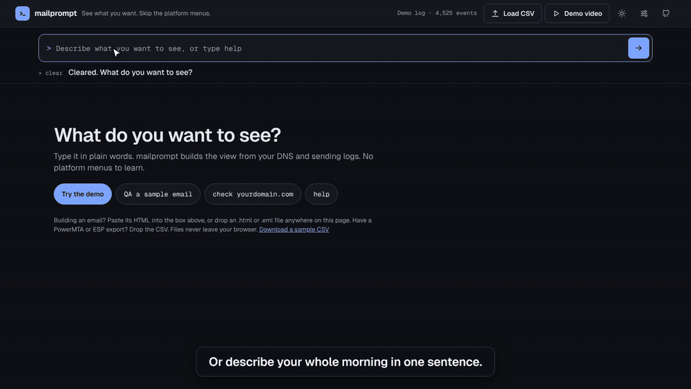

# mailprompt

**See what you want about your email sending. Skip the platform menus.**

mailprompt is a prompt box for email engineers and marketers. Type what you want to see in plain words. It builds the view from your DNS and sending logs as tiles you can resize, rearrange and save.



**Try it now, no install:** [tony007digital.github.io/mailprompt/?demo](https://tony007digital.github.io/mailprompt/?demo)

**Watch the 80-second walkthrough:** [media/mailprompt-demo.mp4](media/mailprompt-demo.mp4)

---

## Why

Every email platform has its own UI. On a normal morning an email engineer opens the ESP dashboard, the MTA logs, a DNS checker, Postmaster Tools and a blocklist site, just to answer *"did anything break overnight?"*

mailprompt flips that. You describe the answer you want, once:

```
show me overnight deferrals, bounces, queue depth per VMTA, and the SPF and DMARC
for news.mybrand.com. Make queues big.
```

It builds that view, tells you in one sentence what needs attention, and lets you save it as your *Morning* view.

- **Better:** the screen matches your workflow, not a vendor's menus. Engineers and marketers build different views from the same box.
- **Faster:** one sentence instead of five tabs. Verdict first, evidence underneath.
- **Saves money:** free and MIT licensed. Runs entirely in your browser, so there's no server to host, no account and no per-seat pricing.

## Run it in 30 seconds

You don't need to install anything. Pick one:

1. **Online:** open [tony007digital.github.io/mailprompt](https://tony007digital.github.io/mailprompt/) and type `demo`.
2. **Offline:** click **Code → Download ZIP**, unzip, and double-click `index.html`.
3. **Clone:**
   ```bash
   git clone https://github.com/tony007digital/mailprompt.git
   cd mailprompt
   open index.html        # Windows: start index.html   Linux: xdg-open index.html
   ```

No build step, no dependencies, no `npm install`.

## What you can ask

| You type | You get |
|---|---|
| `demo` | A fictional bakery's overnight sends (PowerMTA-style log), so you can try everything |
| `check yourdomain.com` | Live SPF, DKIM, DMARC, MX, BIMI, MTA-STS and a bulk-sender readiness check |
| `spf` / `dmarc` / `mx yourdomain.com` | Just that record |
| `dkim s1 yourdomain.com` | DKIM at a specific selector (24 common selectors are checked by default) |
| `show deferrals by provider` | Deferrals grouped by Gmail, Yahoo, Microsoft, Apple, other, with the top code |
| `show bounces` | Bounce reasons: bad address, blocklisted, mailbox full, policy, DNS |
| `show queues` | What's still waiting per VMTA or pool, and how old it is |
| `timeline`, `top codes`, `by campaign` | Hourly chart, top SMTP responses, per-campaign results |
| `why did jane@example.com bounce?` | A full trace for one address with a plain-English verdict |
| `make queues big`, `hide codes` | Resize or remove tiles by asking. You can also drag them and use the size button. |
| `save view as Morning`, `open Morning` | Save and reopen your layout |
| `help` | All of the above, as tap-to-run chips |

Several requests in one sentence work too. Tiles show up in the order you mention them.

## Use your own data

**DNS** for any real domain is looked up live from your browser over DNS-over-HTTPS (Cloudflare, with Google as a fallback). DMARC p=none and missing records come with a **Copy fix** button that hands you a corrected record.

**Sending logs:** drop a CSV anywhere on the page, or click **Load CSV**.

- PowerMTA accounting files work as-is.
- ESP event and bounce exports usually work too. Columns are matched by name, not position: `rcpt` / `email` / `recipient`, `type` / `event` / `status`, `dsnStatus` / `reason` / `response`, `dsnMta`, `vmta` / `pool`, `jobId` / `campaign`, `timeLogged` / `timestamp`.
- Try it with the sample file in [`samples/pmta-accounting-sample.csv`](samples/pmta-accounting-sample.csv).

If your export doesn't load, [open an issue](https://github.com/tony007digital/mailprompt/issues) with its header row. Don't include addresses.

## Privacy

- There is no mailprompt server. Your CSV is read in your browser and never uploaded.
- DNS lookups go to Cloudflare's or Google's public DNS-over-HTTPS resolvers.
- Saved views are stored in your browser's local storage.
- If you add a Claude key (below), it's stored in your browser and sent only to `api.anthropic.com`. The request contains your question and summary numbers, never your log file.

## Optional: ask in your own words

Without a key, mailprompt understands the commands above. Add a [Claude API key](https://console.anthropic.com/) under **Settings** and it also handles anything else, like *"what should I fix first?"*. Claude picks tiles from the same fixed catalog, so it can't invent layouts or numbers. The default model is `claude-haiku-5-5`, and you can change it in Settings.

## How it works

```
index.html         the page
style.css          light and dark themes
js/agent.js        turns what you type into a plan of tiles (rules first, Claude optional)
js/tiles.js        the tile catalog: every view the agent can show
js/dns.js          SPF / DKIM / DMARC / MX / BIMI / MTA-STS checks over DNS-over-HTTPS
js/logs.js         CSV import, provider detection, bounce classification, queues, traces
js/demo-data.js    the fictional demo log and demo DNS records (.example domains)
js/app.js          layout, drag to reorder, sizes, saved views
```

Adding a view means adding one entry to `js/tiles.js` and a keyword to `js/agent.js`.

## Roadmap

- Connectors: ESP APIs (SendGrid, Mailgun, SES, Klaviyo, Braze) and live PowerMTA
- Scheduled views: your Morning view delivered by email or Slack at 8 AM
- An MCP server, so Claude and other agents can use the same tiles
- Approved actions: throttle a queue, suppress an address, publish a DNS fix, each with a confirm step
- More tiles: Gmail Postmaster data, blocklist checks, rendering QA

Ideas and pull requests are welcome.

## License

MIT © 2026 Tony Lucio. See [LICENSE](LICENSE).

Built by [Tony Lucio](https://github.com/tony007digital), email engineer.
